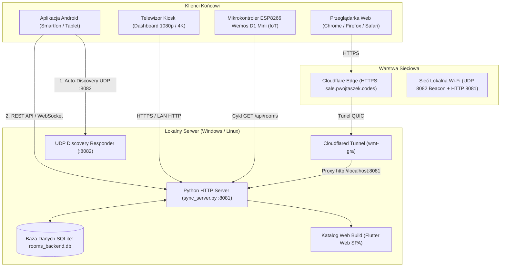

# Dostępność Sal - Podręcznik Architektury dla AI i Programistów (AI Codebase Guide)

> **Wersja projektu**: `1.2.0` (kod wersji: `4`)  
> **Data utworzenia dokumentacji**: 2026-10-20  
> **Lokalizacja repozytorium**: Politechnika Rzeszowska – System Monitorowania i Wizualizacji Dostępności Sal Dydaktycznych & IoT

Dokument ten został przygotowany specjalnie dla modeli sztucznej inteligencji (LLM) oraz nowych programistów w celu natychmiastowego zrozumienia architektury, przepływu danych, schematów baz danych oraz zasad dalszego rozwoju projektu na dowolnym innym urządzeniu.

---

## 1. Cel i Rola Projektu (Executive Summary)

Projekt **„Dostępność Sal”** to kompleksowy, hybrydowy ekosystem służący do monitorowania, zarządzania i prezentacji stanu dostępności sal wykładowych, laboratoriów i stref specjalnych (np. Garaż z wystawą pojazdów, AULA, stoiska tematyczne) w budynku Politechniki Rzeszowskiej.

System integruje:
1. **Aplikację wieloplatformową (Flutter)**:
   - **Web**: Działa w dowolnej przeglądarce (laptop, tablet) pod adresem publicznym [https://sale.pwojtaszek.codes](https://sale.pwojtaszek.codes) lub lokalnie `http://localhost:8081`.
   - **Android**: Aplikacja natywna `.apk` z obsługą autoupdate (`DostepnoscSal.apk`).
   - **Tryb TV / Kiosk Dashboard**: Dedykowany, pełnoekranowy widok na telewizory i infokioski z zegarem czasu rzeczywistego, licznikami sal i automatycznym odświeżaniem co 3 sekundy.
2. **Serwer Synchronizacji i Bazy Danych (Python + SQLite)**:
   - Serwer HTTP REST na porcie `8081`.
   - Wbudowany serwer plików statycznych dla wersji Web.
   - Serwer autoupdate aplikacji mobilnej (`/api/app-version`).
   - Beacon UDP na porcie `8082` do automatycznego wykrywania adresu serwera w sieci lokalnej (LAN Wi-Fi).
3. **Tunel Internetowy (Cloudflare Tunnel `wmt-gra`)**:
   - Bezpieczne wystawienie aplikacji lokalnej do Internetu z certyfikatem HTTPS pod domeną `sale.pwojtaszek.codes` bez konieczności posiadania publicznego adresu IP ani przekierowywania portów na routerze.
4. **Węzeł Sprzętowy IoT (ESP8266 Wemos D1 mini)**:
   - Skaner sieci Wi-Fi i automatyczny klient HTTP/REST.
   - Sprzętowa sygnalizacja stanu sal za pomocą dwukolorowych diod LED (zielona = sala wolna, czerwona = sala zajęta).

---

## 2. Diagram Architektury Systemu (Mermaid)



---

## 3. Schemat Bazy Danych (SQLite)

Główna tabela bazy danych `rooms` w pliku `server/rooms_backend.db` (oraz lokalna kopia SQLite w aplikacji Android) posiada następującą strukturę:

| Kolumna | Typ | Opis |
|---|---|---|
| `id` | `INTEGER PRIMARY KEY AUTOINCREMENT` | Unikalny identyfikator sali |
| `number` | `TEXT UNIQUE NOT NULL` | Oznaczenie sali (np. `'104'`, `'AULA'`, `'9'`, `'HOL'`, `'Garaż'`) |
| `name` | `TEXT NOT NULL` | Nazwa tematyczna pokazu / sali (np. `'Gwiezdne Wojny'`, `'Wirtualny świat'`) |
| `floor` | `TEXT NOT NULL` | Piętro: `'Parter'`, `'Piętro'` lub `'Garaż podziemny'` |
| `category` | `TEXT DEFAULT 'Inne'` | Kategoria: `'Laboratorium'`, `'Wykładowa'`, `'EXTRAS'`, `'Wystawa'` |
| `description` | `TEXT` | Szczegółowy opis prezentacji, warsztatów i aparatury |
| `capacity` | `INTEGER DEFAULT 30` | Pojemność sali (liczba osób) |
| `isAvailable` | `INTEGER DEFAULT 1` | `1` = Wolna / Dostępna (zielony), `0` = Zajęta (czerwony) |
| `customNote` | `TEXT DEFAULT ''` | Notatki organizatora lub dodatkowe komunikaty |
| `updatedAt` | `TEXT` | Znacznik czasu ISO 8601 ostatniej modyfikacji |
| `posX` | `REAL DEFAULT NULL` | Współrzędna X na planie piętra w trybie edycji (px) |
| `posY` | `REAL DEFAULT NULL` | Współrzędna Y na planie piętra w trybie edycji (px) |
| `sortOrder` | `INTEGER DEFAULT 0` | Kolejność sortowania na listach |

> [!IMPORTANT]
> **Obsługa Garażu na Parterze**:  
> Zapytanie serwera o `floor=Parter` (`/api/rooms?floor=Parter`) celowo zwraca również rekord `Garaż podziemny` (`number='Garaż'`). Dzięki temu sala ta wyświetla się w centralnej strefie rzutu Parteru bez konieczności przełączania na osobne piętro.

---

## 4. Przegląd Modułów Kodu (Root Map)

```
pw180088 / DostepnoscSal_Projekt
├── lib/                                    # Kod źródłowy aplikacji Flutter
│   ├── main.dart                           # Punkt wejściowy, motyw ciemny/jasny, routing
│   ├── models/
│   │   ├── room_model.dart                 # Model sali (serializacja JSON, SQLite toMap/fromMap)
│   │   ├── contact_model.dart              # Model kontaktów (narzędzie pomocnicze)
│   │   └── weather_model.dart              # Model pogody (narzędzie pomocnicze)
│   ├── screens/
│   │   ├── room_main_screen.dart           # Główny ekran z mapą sal, listą, filtrami i edycją
│   │   ├── tv_dashboard_screen.dart        # Dedykowany tryb Kiosk / TV (zegar, statystyki, ticker)
│   │   ├── add_edit_room_screen.dart       # Formularz dodawania i edycji parametrów sali
│   │   ├── main_navigation_screen.dart     # Dolna nawigacja i integracja zakładek
│   │   ├── settings_screen.dart            # Ustawienia synchronizacji LAN/Cloud i autoupdate
│   │   ├── address_book_screen.dart        # Książka adresowa (moduł dodatkowy)
│   │   └── weather_home_screen.dart        # Moduł pogody (moduł dodatkowy)
│   ├── widgets/
│   │   ├── interactive_floor_map.dart      # WEKTOROWA MAPA PIĘTER: geometria budynku, zoom, przeciąganie
│   │   ├── room_detail_sheet.dart          # Dolny arkusz ze szczegółami sali i szybkim przełączaniem
│   │   ├── esp_devices_dialog.dart         # Okno konfiguracji i podglądu urządzeń ESP8266
│   │   └── diagnostics_dialog.dart         # Narzędzie diagnostyki połączeń LAN i serwera
│   └── services/
│       ├── room_sync_service.dart          # Zarządca synchronizacji danych, HTTP polling i cache
│       ├── room_database_helper.dart       # Lokalna baza SQLite na Androidzie + fallback pamięciowy Web
│       ├── app_update_service.dart         # Sprawdzanie nowej wersji na serwerze i monit o update
│       ├── app_update_downloader.dart      # Pobieranie i instalacja pliku APK na urządzeniu
│       └── discovery/
│           ├── network_discovery.dart      # Interfejs automatycznego wykrywania serwera w LAN
│           ├── network_discovery_io.dart   # Implementacja gniazda UDP dla Android/Desktop
│           └── network_discovery_web.dart  # Bezpieczna atrapa (fallback) dla przeglądarek Web
├── server/                                 # Backend Python + Baza SQLite
│   ├── sync_server.py                      # REST API, serwer statyczny Web, beacon UDP :8082
│   └── rooms_backend.db                    # Baza danych SQLite z aktualnymi stanami sal
├── esp8266_d1mini/                         # Oprogramowanie mikrokontrolera (Arduino C++)
│   └── esp8266_d1mini.ino                  # Skaner sieci Wi-Fi, zapytania HTTP do serwera, obsługa LED
├── android/                                # Projekt natywny Android (Gradle, Manifest, ikony)
├── web/                                    # Zasoby aplikacji Web (index.html, manifest, ikony PWA)
├── test/                                   # Testy jednostkowe i widgetów Flutter
├── cloudflare_config_sample.yml            # Przykładowa konfiguracja tunelu Cloudflare
├── run_server_and_tunnel.bat               # Główny skrypt uruchomieniowy Windows
├── server_control.ps1                      # Skrypt PowerShell do zarządzania serwerem w tle
├── pubspec.yaml                            # Konfiguracja zależności Flutter i metadane wersji
└── analysis_options.yaml                   # Reguły statycznej analizy kodu Darta
```

---

## 5. Kluczowe Rozwiązania Architektoniczne

### 5.1. Wektorowy Rzut Budynku i Skalowanie (`interactive_floor_map.dart`)
- **Geometria budynku Politechniki**: Obrys budynku jest rysowany wektorowo za pomocą `CustomPainter` (`_FloorMapPainter`). Składa się z pionowego korytarza głównego, połączonego pod kątem skrzydła bocznego, holu wejściowego oraz strefy centralnego dziedzińca.
- **Automatyczne skalowanie (Auto-Fit)**:
  Wizualizacja wykorzystuje `LayoutBuilder` i `FittedBox`. Współczynnik skali jest dynamicznie obliczany:
  ```dart
  final fitScale = min(constraints.maxWidth / 360.0, constraints.maxHeight / 520.0).clamp(0.25, 1.4);
  ```
  Dzięki temu na dowolnym ekranie (od małego smartfona po 4K TV) cały plan piętra mieści się w 100% w oknie bez niepożądanego ucinania krawędzi.
- **Powiększanie / Oddalanie (Zoom)**:
  Zastosowano kontroler `TransformationController` z zakresem `minScale: 0.25` do `maxScale: 3.5`.
  W prawym dolnym rogu umieszczono przyciski `[-]`, `[⛶]` (dopasuj do ekranu) oraz `[+]`.
- **Tryb Edycji Rozkładu Sal**:
  Po włączeniu trybu edycji sale można dowolnie przeciągać palcem lub myszką. Przesunięcie uwzględnia współczynnik `1 / fitScale`, co zapewnia idealną precyzję 1:1 pod kursorem. Pozycje są natychmiast synchronizowane z bazą danych (`posX`, `posY`).

### 5.2. Widok TV / Kiosk (`tv_dashboard_screen.dart`)
- Zaprojektowany z myślą o dużych ekranach i infokioskach.
- Prezentuje równolegle oba piętra (Parter z Garażem oraz I Piętro) w formacie side-by-side.
- Posiada live-ticker z płynnie przewijanym statusem wszystkich sal.
- Automatycznie odświeża dane z serwera w tle co 3 sekundy.

### 5.3. Automatyczne Wykrywanie Serwera w Sieci Lokalnej (UDP Auto-Discovery)
- Serwer Pythona uruchamia w osobnym wątku gniazdo UDP na porcie `8082`.
- Aplikacja mobilna po podłączeniu do Wi-Fi wysyła pakiet broadcastowy `DISCOVER_ROOM_SERVER`.
- Serwer odpowiada pakietem JSON zawierającym swój aktualny adres IP w sieci LAN.
- Aplikacja automatycznie konfiguruje adres synchronizacji, eliminując potrzebę ręcznego wpisywania adresu IP przez użytkownika.

### 5.4. Tunel Cloudflare i Praca w Tle na Windows
- Skrypt [run_server_and_tunnel.bat](run_server_and_tunnel.bat) uruchamia procesy Pythona oraz Cloudflared jako niezależne procesy Windows (`-WindowStyle Hidden`).
- Konsola może zostać zamknięta po 10 sekundach, a serwer i tunel kontynuują pracę w tle.
- Wybranie opcji `[4]` z menu zatrzymuje tylko procesy związane z serwerem i tunelem, nie naruszając innych usług systemowych.
